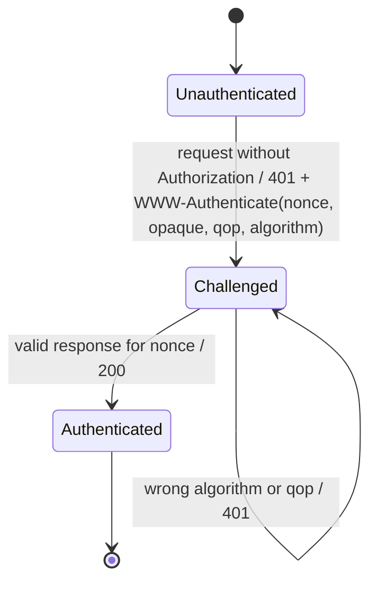
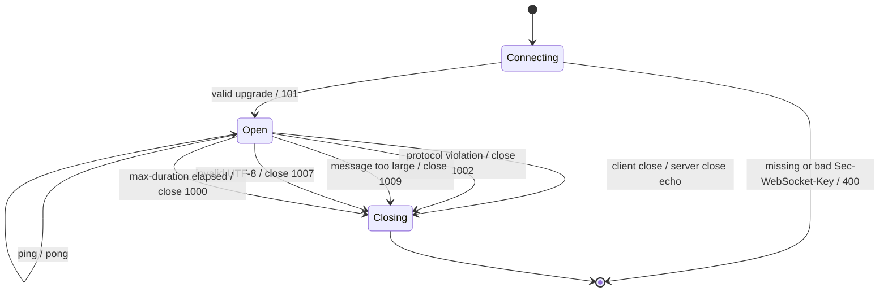

# Test design

How each test-design technique in the [test strategy](TEST-STRATEGY.md) is applied, with the derivations behind the
test cases. Section numbers in brackets refer to the ISTQB Foundation syllabus CTFL v4.0. Definitions are
paraphrased; the syllabus is the authority.

Every test carries the tag of the technique that produced it, so [TRACEABILITY.md](TRACEABILITY.md) can list every test
per technique and level.

**Defects found by applying these techniques** (each fixed with a regression test):

| # | Technique | Defect |
|---|---|---|
| 1 | Error guessing (unit) | `/delay/1e18`, `/delay/Infinity` answered **500**: overflow while formatting the error |
| 2 | State transition (unit) | WebSocket text checked per fragment: a UTF-8 character split across fragments was rejected with 1007 |
| 3 | Error guessing (unit) | asctime dates with a one-digit day (`Jan  2`) were not parsed, so `If-Modified-Since` in that format was ignored |
| 4 | Equivalence partitioning + reading the oracle | `/redirect-to` sent the raw input as `Location`; `/\evil.com` was followed by browsers to `evil.com` |
| 5 | Equivalence partitioning | `GoUrl` accepted `1http://x` and bad fragment escapes, which Go rejects |
| 6 | Decision table (allow-list) | With an allow-list, `///evil.com` and `https:evil.com` were allowed (as in the reference); hardened |
| 7 | State transition (integration) | WebSocket `max-duration` was a no-op on Tomcat: `WebConnection.close()` only sets flags |
| 8 | Exploratory (ES-01) | `/response-headers?Transfer-Encoding=chunked` emitted conflicting framing headers |
| 9 | Checklist (axe-core, E2E) | Landing page links in dark mode used the default `#0000ee` on `#12151b`: contrast 1.94:1 (WCAG AA needs 4.5:1) |
| 10 | Exploratory (ES-02) | PUT/PATCH/DELETE form bodies were lost (Spring's `FormContentFilter` consumed them); the body partitions had only been tested with POST |

The E2E suite also found two defects in the **test framework itself**: the Selenium tracing listener was a private class (navigation silently missing from the traceability matrix), and Swagger UI's lazy rendering needed a scrolling page object; both are fixed and commented.

**Design errors found by running the tests** (the tests were wrong, not the product): `/bytes/0` is valid,
digest accepts the client's algorithm, plain-seconds durations truncate. Each correction cites the reference
source. Keeping both lists is deliberate: a test design is a hypothesis about the product.

| Tag | Annotation | Technique |
|---|---|---|
| `tech:ep` | `@EquivalencePartitioning` | Equivalence partitioning |
| `tech:bva` | `@BoundaryValue` | Boundary value analysis |
| `tech:decision-table` | `@DecisionTable` | Decision table testing |
| `tech:state-transition` | `@StateTransition` | State transition testing |
| (no tag) | (none: derived by reading the code, see section 5) | Statement and branch testing |
| `tech:error-guessing` | `@ErrorGuessing` | Error guessing |
| `tech:checklist` | `@ChecklistBased` | Checklist-based testing |
| `tech:atdd` | `@AcceptanceTest` | Acceptance criteria / ATDD |
| `tech:pairwise` | `@Pairwise` | Pairwise testing (CTAL-TA) |
| `tech:classification-tree` | `@ClassificationTree` | Classification tree (CTAL-TA) |
| `tech:use-case` | `@UseCase` | Use-case testing (CTAL-TA) |
| `tech:property` | `@PropertyBased` | Property-based testing (beyond ISTQB) |
| `tech:exploratory` | `@ExploratoryFinding` | Regression test for an exploratory finding |
| `type:security` | `@SecurityTest` | Security negative test (a test type, used with a technique tag) |

---

## 1. Equivalence partitioning [4.2.1]

*Divide the input (or output) domain into partitions whose members the software is expected to treat the same way;
test at least one value from each partition. Each Choice coverage is the minimum.*

### 1.1 `/status/{code}`

The obvious partition by status class (1xx–5xx) is **not** enough. Several codes inside a class come with extra
headers or a body, so the implementation treats them differently. They are partitions of their own:

| # | Partition | Representative | Expected |
|---|---|---|---|
| V1 | 1xx, `103` (interim response supported) | 103 | 103 interim, then final 200 |
| V2 | 1xx other than 101/103 | 102 | Final 200 only (deviation G-ref in COMPATIBILITY) |
| V3 | `101` | 101 | Final 101 |
| V4 | 2xx | 201 | Status only, empty body |
| V5 | 3xx redirecting to `/redirect/1` (301/302/303/305/307) | 303 | `Location: /redirect/1` |
| V6 | 3xx with HTML body (300, 308) | 308 | `Location: /image/jpeg`, HTML body |
| V7 | 3xx without special case (304, 306, 309–399) | 304 | No `Location`, no body |
| V8 | 401 | 401 | `WWW-Authenticate: Basic …` |
| V9 | 402 / 418 (joke bodies) | 418 | `X-More-Info`, body text |
| V10 | 406 | 406 | JSON body, `Content-Type` replaced (not duplicated) |
| V11 | 407 | 407 | `Proxy-Authenticate` |
| V12 | Other 4xx / 5xx | 503 | Status only |
| V13 | Weighted list `200:0.9,500:0.1` | with fixed `seed` | One of the listed codes |
| I1 | Below range | 99 | 400 |
| I2 | Above range | 600 | 400 |
| I3 | Non-numeric | `abc` | 400, Go `strconv` message |
| I4 | Malformed weight | `200:x` | 400 |

The status-class partitions alone would have missed V2, V6, V7 and V10. Each of those has needed a separate fix in this
project's history. *Tests:* `StatusCodePartitionTest` (API).

### 1.2 Other partitioned inputs

| Input | Partitions |
|---|---|
| `Accept` on `/image` | Each supported type (webp, svg, jpeg, png, avif) · `image/*` · `*/*` (415, see compat notes) · unsupported (`text/plain`) · missing header |
| HTTP method per route | Allowed method · disallowed method (405 + `Allow`) · `HEAD` · `OPTIONS` (CORS preflight) |
| Content type on `/response-headers` | Safe (`application/json`, `text/plain`) · dangerous (`text/html`, `image/svg+xml`) · malformed |
| Body on `/post` | JSON · form-urlencoded · multipart · empty · invalid JSON · unknown type |

---

## 2. Boundary value analysis [4.2.2]

*For ordered partitions, test the boundary values. We use **3-value BVA**: the boundary and both neighbours.*

Limits are tested against a server started with **lowered limits**. The boundaries move to cheap values but the
code paths stay the same. A test-only profile sets `max-duration=1s`, `max-body-size=1KB`, `max-stream-lines=5`,
`max-links=5`, `max-redirects=3`. The `Boundaries.around(limit)` helper yields `limit−ε, limit, limit+ε` for a
given precision.

| Boundary | Values (lowered limits) | Expected |
|---|---|---|
| `/delay/{d}` upper | 999ms · 1s · 1001ms | 200 · 200 · 400 |
| `/delay/{d}` upper, plain seconds | 1.001 · 1.002 | **200** · 400: float truncation, `1.001 × 1000 = 1000.999…` → 1000 ms (same in Go). Use Go syntax for exact boundaries. |
| `/delay/{d}` lower | −0.001 · 0 · 0.001 | 400 · 200 · 200 |
| `/bytes/{n}` | −1 · 0 · 1 and 1023 · 1024 · 1025 | 400 · **200 (empty)** · 200 and 200 · 200 · 400 (the design first said 0 → 400; the reference source special-cases 0) |
| Request body size | 1023 · 1024 · 1025 bytes | 200 · 200 · 400 `http: request body too large` (Go's `MaxBytesReader`, not 413) |
| `/stream/{n}` vs `max-stream-lines` | 4 · 5 · 6 | 4 · 5 · 5 lines (clamped, not rejected) |
| `/stream/{n}` lower | 0 · 1 · 2 | 1 · 1 · 2 lines (clamped to at least 1) |
| `/links/{n}` | −1 · 0 · 1 and 4 · 5 · 6 | 400 · 200 · 200 and 200 · 200 · 400 |
| `/redirect/{n}` vs `max-redirects` | 2 · 3 · 4 | 302 · 302 · 400 |
| `/redirect/{n}` lower | 0 · 1 | 400 · 302 → `/get` |
| `/status/{code}` | 99 · 100 · 101 and 598 · 599 · 600 | 400 · 200 · 101 (raw socket: Apache HttpClient waits forever on a final 101) and 598 · 599 · 400 |
| `/redirect-to?status_code` | 299 · 300 · 301 and 398 · 399 · 400 | 400 · 300 · 301 and 398 · 399 · 400 |
| `/drip?duration=` | 999ms · 1s · 1001ms | 200 · 200 · 400 |

Three of these boundaries behave differently from what a tester might assume, and the tests document it:
`/stream/{n}` **clamps** at both ends instead of rejecting; `/delay` checks its limit **inclusively**
(`min ≤ d ≤ max`, as in go-httpbin's `parseBoundedDuration`); and an oversized body gives **400, not 413**, because
the reference uses Go's `MaxBytesReader`. *Tests:* `LimitBoundaryTest` (API, against a second in-process server with lowered limits), `GoDurationTest` and `StatusCodesTest` (unit). The lowered-limits profile also proves the
limits are read from configuration (risk R13).

---

## 3. Decision table testing [4.2.3]

*Model combinations of conditions and the resulting actions; each column (rule) is a test case. Rules with the same
outcome are collapsed with "–" (don't care) where the implementation provably ignores the condition.*

### 3.1 `/redirect-to`

The conditions are evaluated **in this order** in `RedirectController.redirectTo`. The order matters: an invalid
`status_code` on a forbidden URL gives **403, not 400**.

| Condition | R1 | R2 | R3 | R4 | R5 | R6 | R7 | R8 |
|---|---|---|---|---|---|---|---|---|
| `url` present | N | Y | Y | Y | Y | Y | Y | Y |
| `url` parses | – | N | Y | Y | Y | Y | Y | Y |
| Allow-list configured | – | – | N | N | N | N | Y | Y |
| Target allowed (absolute, or starts with `/`; host on allow-list if configured) | – | – | N | N | Y | Y | N | Y |
| `status_code` given | – | – | N | Y (invalid) | N | Y (300–399) | – | N |
| **Status** | 400 | 400 | 403 | 403 | 302 | given | 403 + allow-list text | 302 |
| **`Location`** | – | – | – | – | url | url | – | url |

Plus R9: allowed target and `status_code` outside 300–399 → 400. *Test:* `DecisionTableTest.redirectTo` (API), data in `redirect-to.csv`.

### 3.2 Conditional requests on `/etag/{etag}`

Semantics follow Go's `http.ServeContent`: `If-Match` is evaluated before `If-None-Match`, and `If-None-Match` uses
weak comparison.

| Condition | R1 | R2 | R3 | R4 | R5 | R6 | R7 |
|---|---|---|---|---|---|---|---|
| `If-Match` | – | – | – | match | no match | no match | `*` |
| `If-None-Match` | – | match | no match | – | – | match | – |
| Method GET/HEAD | Y | Y | Y | Y | Y | Y | Y |
| **Status** | 200 | 304 | 200 | 200 | 412 | 412 | 200 |

Extra rules for non-safe methods (`PUT` + `If-None-Match` match → 412) and for weak tags (`W/"x"` matches `"x"` in
`If-None-Match`). Where the derivation from Go's source is uncertain, the Go handler's own tests are the tiebreaker.
*Tests:* `ServeContentTest` (unit, full table plus date preconditions and `If-Range`), `DecisionTableTest.etagPreconditions` (API, on the wire).

### 3.3 Basic auth vs hidden basic auth

| Condition | R1 | R2 | R3 | R4 |
|---|---|---|---|---|
| `Authorization: Basic` present and decodable | N | Y | Y | Y |
| User matches | – | N | Y | Y |
| Password matches | – | – | N | Y |
| **`/basic-auth`** | 401 + challenge | 401 + challenge | 401 + challenge | 200 |
| **`/hidden-basic-auth`** | 404, no challenge | 404 | 404 | 200 |

---

## 4. State transition testing [4.2.4]

*Model the states and the events that move between them; cover every valid transition (0-switch coverage) and
selected invalid transitions.*

### 4.1 Digest authentication handshake



Valid transitions: 3. Invalid ones tested: a response computed for another URI, a wrong password, and a
malformed `Authorization` header. MD5 credentials sent to a SHA-256 endpoint were designed as invalid, but the
reference's `digest.Check` uses the algorithm the *client* names, so they are accepted; the test pins that. *Tests:* `DigestHandshakeStateTest` (API), `DigestAuthRulesTest` (unit).

### 4.2 WebSocket connection (`/websocket/echo`)



Invalid events tested in state Open: unmasked client frame, reserved RSV bits, a close payload of 1 byte, a reserved
close code (1005), and a continuation frame without a start frame. *Tests:* `EchoSessionStateTest` (unit, every transition), `WebSocketUpgradeIT` (through Tomcat's upgrade), plus the browser journey in E2E.

### 4.3 Cookie jar in a browser (E2E)

States: *Empty* → `/cookies/set?a=1` → *Has a* → `/cookies/set?b=2` → *Has a, b* → `/cookies/delete?a` → *Has b* →
`/cookies/delete?b` → *Empty*. A real browser jar is the only oracle that also checks `Path`, expiry and `SameSite`
handling as a learner experiences them.

---

## 5. Statement and branch testing [4.3.1, 4.3.2]

- Applied by reading the code, not by a coverage tool: the hand-ported Go algorithms in `support`, `auth` and
  `websocket` (risks R8–R11) get a unit test for each branch of the Go original, derived from its source.
- Section 14 checks, by deliberate fault injection, that the tests notice when a branch is wrong.

---

## 6. Error guessing [4.4.1]

*Anticipate defects from experience and known failure patterns; a fault attack list makes it systematic.* Each test
states the fault it is guessing at.

| Fault guessed | Inputs |
|---|---|
| Percent-decoding errors | `%`, `%4`, `%%`, `%zz`, `%00`, double-encoded `%252F` |
| Header injection | `\r\n`, `%0d%0a` in `/response-headers` and `/cookies/set` values |
| Unicode handling | Emoji, combining characters, overlong UTF-8, lone surrogates in query and JSON body |
| Number parsing | `NaN`, `Infinity`, `1e309`, `-0`, `+5`, ` 5`, `0x10`, `9223372036854775808` |
| Duration parsing | `1.5.5s`, `5`, `5ss`, `-1s`, `1h` (beyond limit), `.5s`, `5.s` |
| Duplicate parameters | `?a=1&a=2` ordering, `?a` vs `?a=` |
| Empty bodies | `Content-Type: application/json` with an empty body; `Content-Length: 0` on `/post` |
| Range edge cases | `bytes=-0`, `bytes=0-0`, `bytes=5-1`, `bytes=0-0,0-0`, 1000 ranges |
| Client-repaired input | Malformed escapes and bare keys sent through a raw socket (`RawHttp`): REST Assured refuses `%4` and normalises `?a&a=` |

*Tests:* `ErrorGuessingTest` and `SecurityNegativeTest` (API), plus `@ErrorGuessing` unit tests in every Go port.

---

## 7. Checklist-based testing [4.4.3]

An HTTP conformance checklist, applied by **one parameterised test over every route** in the endpoint inventory, so
a new endpoint is checked without anyone writing a new test:

1. `HEAD` returns the same status and headers as `GET`, with no body.
2. `Content-Length`, when present, equals the body length.
3. `405` responses include an `Allow` header listing the allowed methods.
4. `204` and `304` responses have no body.
5. Every response has a `Date` header.
6. Every response carries `Access-Control-Allow-Origin` (CORS is on by default).
7. An `OPTIONS` preflight returns 200 with `Access-Control-Allow-Methods`.
8. JSON responses parse and declare `application/json; charset=utf-8` (Tomcat spacing tolerated, see COMPATIBILITY).

Routes whose purpose conflicts with an item (e.g. `/status/204` and item 8) are listed as exclusions next to the
test, with the reason. *Test:* `HttpConformanceChecklistTest` (API), about 430 checks.

---

## 8. Exploratory testing [4.4.2]

Session-based, time-boxed, with written charters and session sheets. See
[EXPLORATORY-CHARTERS.md](EXPLORATORY-CHARTERS.md). Every finding becomes a scripted regression test,
linked from the session sheet.

---

## 9. Acceptance criteria and ATDD [4.5.2, 4.5.3]

E2E journeys are written as acceptance criteria before the page objects exist, in Given/When/Then form, and kept in
the test's `@DisplayName` and Javadoc. Example:

> **Journey 2: HTML form round-trip**
> *Given* a learner opens `/forms/post`
> *When* they fill in name, telephone, email, two toppings, a delivery time and comments, and submit
> *Then* the response page shows each field under `form`, with both toppings as a list
> *And* the request was sent as `application/x-www-form-urlencoded`

---

## 10. Pairwise testing (CTAL-TA)

*Test every pair of parameter values at least once instead of every combination.*

**`/drip` model** (PICT syntax, checked in as `drip.pict`):

```text
duration:  0, 0.5s, 1s
numbytes:  1, 10, 1024
code:      200, 404, 503
delay:     0, 0.5s
```

All combinations: 3 × 3 × 3 × 2 = 54. Pairwise: about 10. The generated rows are checked in as `drip.csv`, so the
build doesn't need PICT installed. The same approach applies to `/range` (size × `chunk_size` × `duration` ×
`Range` header class). *Test:* `DripPairwiseTest` (API); it first verifies that the checked-in rows cover every pair of the model.

---

## 11. Classification tree (CTAL-TA)

The `Range` request header for `/range/{n}` and `/etag`:

```text
Range request
├── Syntax
│   ├── absent
│   ├── single:     bytes=a-b
│   ├── open-ended: bytes=a-
│   ├── suffix:     bytes=-n
│   ├── multiple:   bytes=a-b,c-d
│   └── malformed:  bytes=x / items=0-1 / bytes=5-1
├── Satisfiability
│   ├── fully inside the resource
│   ├── overlapping the end (clamped)
│   └── entirely beyond the end (unsatisfiable)
└── Resource size
    ├── 1 byte
    ├── typical (26)
    └── max-body-size
```

Combinations are chosen so each leaf appears at least once. Impossible combinations, such as malformed syntax with
satisfiability, are excluded. Expected results: 200, 206 single, 206 `multipart/byteranges`, or 416 with
`Content-Range: bytes */n`. *Tests:* `RangeClassificationTreeTest` (unit, every combination), `RangeClassificationTreeApiTest` (API, every leaf on the wire).

---

## 12. Use-case testing (CTAL-TA)

The nine E2E journeys in the strategy are the use cases, each with a main flow and the alternative flows that
matter: basic auth with and without credentials, a redirect chain within and beyond the browser's limit, and a
form with and without optional fields.

---

## 13. Property-based testing (beyond ISTQB)

| Property | Generator |
|---|---|
| `GoDuration.parse(GoDuration.format(d)) == d` for all representable durations | Random nanosecond counts within ±290 years |
| `QueryString.parse(encode(m))` equals `m` | Random multimaps, Unicode keys and values |
| `GoRandom(seed)` yields the same sequence for the same seed | Random seeds |
| `WebSocketFrames` decode(encode(frame)) == frame, for every opcode and payload size class (≤125, 126–65535, >65535) | Random payloads |

Each sample is generated from a recorded seed (`-Dproperty.seed=` explores new inputs, `-Dproperty.samples=` sets the count; default 500). A failing sample is reduced by hand to a minimal example and kept as a fixed unit test.

---

## 14. Evidence that the tests detect faults

Each technique was checked once by **deliberate fault injection**: break the code, watch the targeted test fail,
then restore it. Run on 2026-11-10:

| Injected fault | Expected to be caught by | Result |
|---|---|---|
| `/delay` limit check `d <= max` → `d < max` | BVA, ON-boundary value | **Caught** by `GoDurationTest.upperLimitIsInclusive` [ON = 10s]: exactly the value 3-value BVA exists for |
| `/redirect-to` checks status before the allow-list | Decision table rule R4 | **Caught** by `DecisionTableTest.redirectTo` row 5 (R4: forbidden target + invalid status) |
| `If-None-Match` uses strong comparison | Decision table weak-tag rule | **Caught** by `ServeContentTest.entityTagPreconditions` row 9 (`W/"v1"` → 304) |
| 406 adds a second `Content-Type` | EP V10 | **Not caught, and not observable:** Tomcat keeps a single `Content-Type` on the wire, so the change is an equivalent mutant at API level. A unit assertion on the `ResponseEntity` would catch it; deliberately not added, because the wire is what learners see. |
| WebSocket accepts unmasked client frames | State transition invalid event | **Caught** twice: `WebSocketFramesTest.unmaskedClientFramesAreAProtocolError` and `EchoSessionStateTest.unmaskedFrame` |
